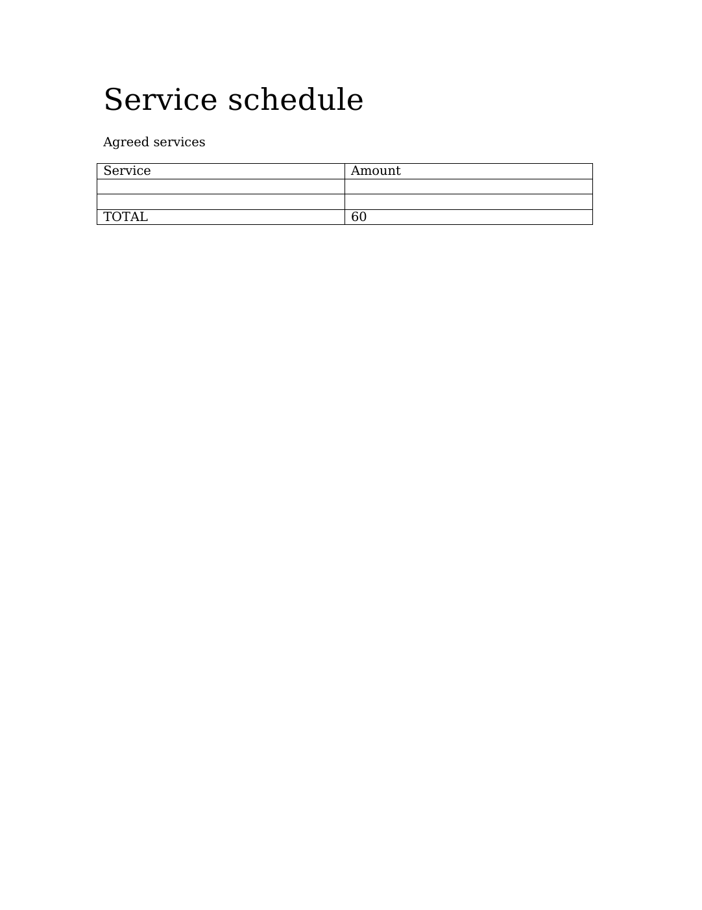
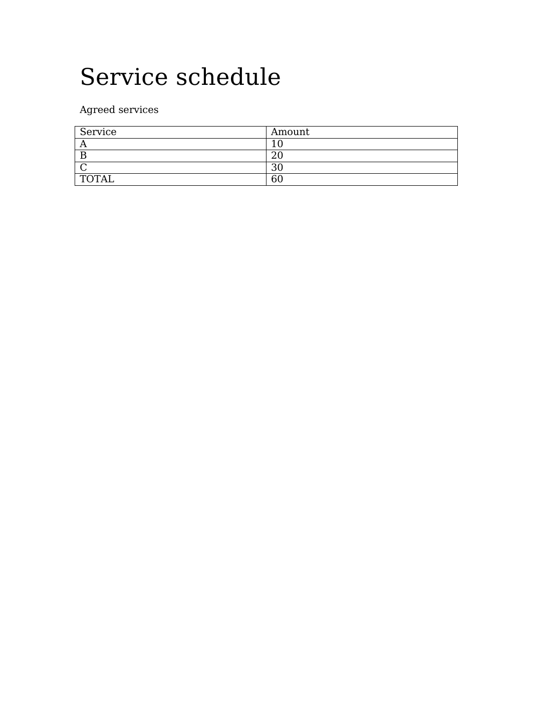

# Rendered before and after examples

These are synthetic forms generated by the versioned [evaluation corpus](../../evaluation/corpus.json). The outputs use authored model-response fixtures. They demonstrate document editing, not measured live-model accuracy.

All eight full-page PNGs were rendered with LibreOffice and Poppler on an isolated Ubuntu GitHub Actions runner and visually inspected. Every source and output is one page. Reproduce the files with the [evaluation and rendering commands](../../evaluation/README.md).

## Field values

| Template | Filled copy |
| --- | --- |
|  |  |

Company and date labels retain their surrounding text while the blanks receive the selected source values.

## Checkbox selection

| Template | Filled copy |
| --- | --- |
|  |  |

The second option is selected without changing the earlier unselected option.

## Table expansion before a total

| Template | Filled copy |
| --- | --- |
|  |  |

An extra data row is inserted above the existing TOTAL row. The total itself is preserved; the application does not calculate or validate totals.

## Null and zero

| Template | Filled copy |
| --- | --- |
|  |  |

JSON null produces an empty cell and numeric zero remains `0`.

These small forms deliberately make individual behaviors easy to inspect. A production evaluation also needs representative documents, semantic labels, live-model measurements, and review in the target Word environment. The supplied large procurement template is not claimed to have pixel-identical rendering across applications.
